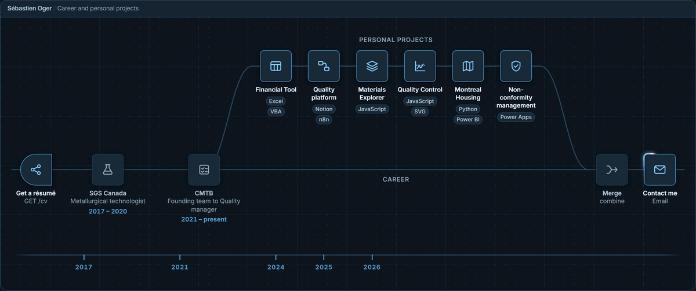
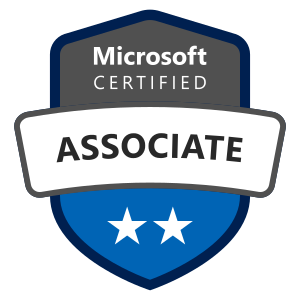
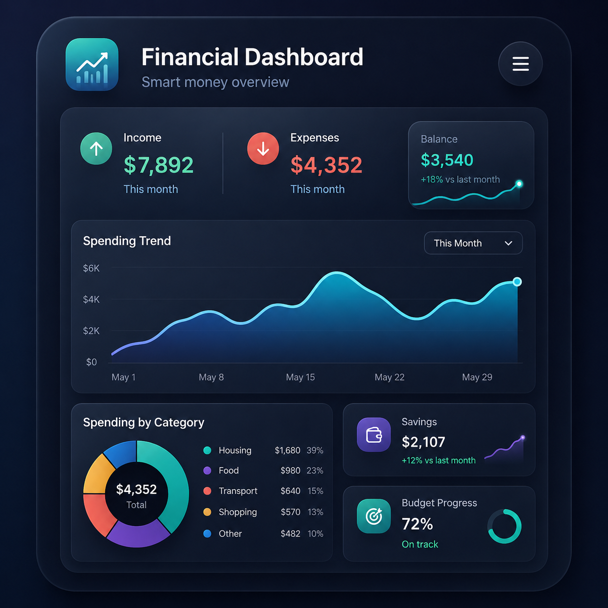
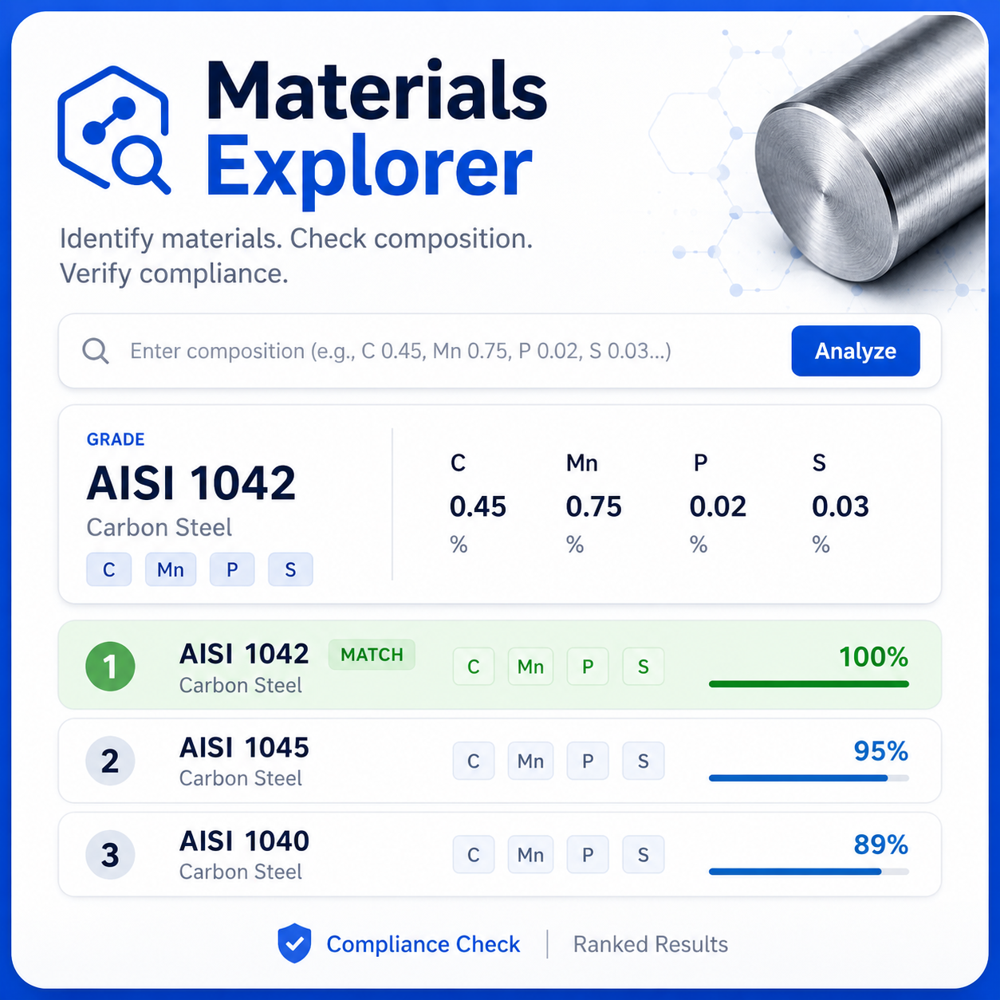
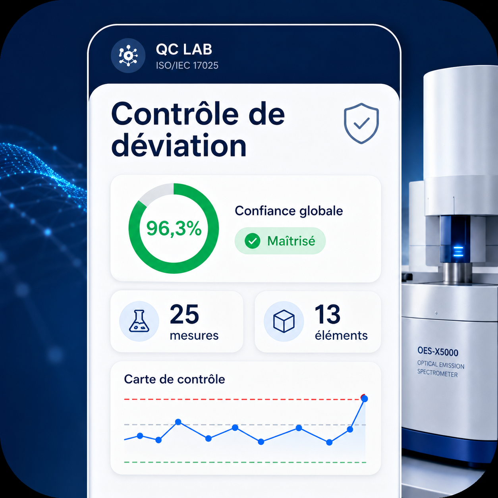

# Sébastien Oger

**Qualité, processus, données.** 
Dix ans en laboratoire accrédité ISO/IEC 17025, aujourd'hui au croisement de l'analyse de données, de l'automatisation et de la conception de solutions métier. 
Montréal, Québec · Ouvert aux opportunités

 

**[→ Explorer le portfolio interactif](https://sebastienoger.ca/)** 
Six projets publiés · trois outils à essayer en ligne · trois certifications Microsoft

---

## Stack

**Données et BI** 

**Power Platform et automatisation** 

**Conception, IA et outils** 

**Référentiel qualité** 

---

## À propos

Au fil de dix ans en environnement ISO/IEC 17025, dont six à piloter le système de management de la qualité d'un laboratoire d'essais accrédité, j'ai appris à transformer les problèmes de terrain en solutions concrètes : outils de suivi, automatisations, applications et analyses de données. Je développe cette approche depuis plus de cinq ans, dans mon emploi comme dans mes projets personnels, et je l'ai professionnalisée par des certifications, dont Power BI Data Analyst (PL-300). J'apporte à chaque projet ce que la qualité m'a appris : la traçabilité des données, la maîtrise des processus, la culture de la preuve et l'exigence de fiabilité du résultat.

---

## Certifications

<table>
  <tr>
    <td align="center" width="33%">
      
       
      <strong>PL-300</strong>
       
      Power BI Data Analyst Associate
       
      Obtenue en juin 2026 · <a href="https://learn.microsoft.com/api/credentials/share/fr-fr/Sbastien-2434/6C8AE8593C66DBE6?sharingId=C8B1AEFFEC3D7E35">Vérifier chez Microsoft</a>
    </td>
    <td align="center" width="33%">
      
       
      <strong>DP-900</strong>
       
      Azure Data Fundamentals
       
      Obtenue en juillet 2026 · <a href="https://learn.microsoft.com/api/credentials/share/fr-fr/Sbastien-2434/B13FCD58F84B8C11?sharingId=C8B1AEFFEC3D7E35">Vérifier chez Microsoft</a>
    </td>
    <td align="center" width="33%">
      
       
      <strong>PL-900</strong>
       
      Power Platform Fundamentals
       
      Obtenue en août 2026 · <a href="https://learn.microsoft.com/api/credentials/share/fr-fr/Sbastien-2434/1D5D347F501A4599?sharingId=C8B1AEFFEC3D7E35">Vérifier chez Microsoft</a>
    </td>
  </tr>
</table>

**Attestations Coursera**

- **Microsoft Power BI Data Analyst** — certificat professionnel (Microsoft) · 8 cours · 187 h · [Vérifier sur Coursera](https://www.coursera.org/account/accomplishments/professional-cert/BP3I3YKFLCTB) · [PDF](./Certificats/MicrosoftPowerBIDataAnalystProfessionalCertificate.pdf)
- **Databases and SQL for Data Science with Python** — IBM · 18 h · [Vérifier sur Coursera](https://coursera.org/share/0e4a0668c80de8d6851375e30e4e9cca) · [PDF](./Certificats/IBM-Database-and-SQL-for-data-Science-with-Python.pdf)
- **Microsoft Azure Data Fundamentals DP-900 Exam Prep** — Microsoft · [Vérifier sur Coursera](https://coursera.org/share/fdc3b0d0fdf28e6f53ec052b75e2d07e)
- **Microsoft Power Platform Fundamentals PL-900 Exam Prep** — Microsoft · [Vérifier sur Coursera](https://coursera.org/share/a9c9c65e5085d0ffe5e29c0c6001d5c6)

Le parcours complet — dix-huit cours, 263 heures en sept mois, avec un travail à côté : **[sebastienoger.ca/certifications](https://sebastienoger.ca/certifications)**

---

## Projets

<table>
  <tr>
    <td align="center" width="50%">
      
       
      <strong><a href="https://sebastienoger.ca/projets/financial-management-tool">Financial-management-tool</a></strong>
        
      Outil de finance personnelle complet (Excel · VBA) — budget, suivi des dépenses, objectifs et automatisation.
        
      <a href="https://sebastienoger.ca/projets/financial-management-tool">Voir sur le portfolio</a> · <a href="https://github.com/WealthFinPilot/Financial-management-tool">Dépôt GitHub</a>
    </td>
    <td align="center" width="50%">
      
       
      <strong><a href="https://sebastienoger.ca/projets/quality-management-system">Quality-management-system-platform</a></strong>
        
      Plateforme de Système Qualité avec Notion + n8n, pour laboratoire industriel accrédité ISO/IEC 17025.
        
      <a href="https://sebastienoger.ca/projets/quality-management-system">Voir sur le portfolio</a> · <a href="https://github.com/WealthFinPilot/Quality-management-system-platform">Dépôt GitHub</a>
    </td>
  </tr>
  <tr>
    <td align="center" width="50%">
      
       
      <strong><a href="https://sebastienoger.ca/projets/materials-explorer">Materials-explorer</a></strong>
        
      Un outil qui automatise l'identification et la vérification de conformité des matériaux, classés par score de confiance.
        
      <a href="https://sebastienoger.ca/projets/materials-explorer">Essayer sur le portfolio</a> · <a href="https://github.com/WealthFinPilot/Materials-explorer">Dépôt GitHub</a>
    </td>
    <td align="center" width="50%">
      
       
      <strong><a href="https://sebastienoger.ca/projets/quality-control-by-data">Quality-Control-by-Data</a></strong>
        
      Surveiller, détecter, corriger — maîtriser la dérive d'un équipement d'analyse de précision dans le temps.
        
      <a href="https://sebastienoger.ca/projets/quality-control-by-data">Essayer sur le portfolio</a> · <a href="https://github.com/WealthFinPilot/Quality-Control-by-Data">Dépôt GitHub</a>
    </td>
  </tr>
</table>

**Aussi sur le portfolio**

- **[Gestion des non-conformités](https://sebastienoger.ca/projets/nonconformity-management)** — Power Apps · Power Automate · SharePoint. Une application qui porte tout le cycle d'une non-conformité en laboratoire accrédité ISO/IEC 17025, de la déclaration au rapport signé. · [Dépôt GitHub](https://github.com/WealthFinPilot/powerapps-gestion-non-conformites)
- **[Montreal Housing](https://sebastienoger.ca/projets/montreal-housing/)** — Python · PostgreSQL · Power BI · n8n. Premier achat : quels secteurs restent accessibles à Montréal ? · [Dépôt GitHub](https://github.com/WealthFinPilot/montreal-housing-intelligence)

---

**[sebastienoger.ca](https://sebastienoger.ca/)** · [LinkedIn](https://www.linkedin.com/in/s%C3%A9bastien-oger-49009382) · [Me contacter](https://sebastienoger.ca/contact) · [Obtenir un CV](https://sebastienoger.ca/cv)

